# Звіт до лабораторної роботи № 4

**Виконала:** Речина Ірина Максимівна
**Рівень:** «Добре»

## 1. Загальні дані

- Базовий тег: `v0.3.0`; робоча гілка: `lab/4-authorization`; фінальний тег: `v0.4.0`
- Vulnerable commit: `1550981c483b9801d2d70dcecf113c9a804014dd`
- Fixed commit: `<FIXED_SHA>`
- Результат тестів на fixed-стані: `Passed: 30, Failed: 0`

## 2. Матриця доступу і політика відмов

Повна матриця: [`access-matrix.md`](access-matrix.md).

- Id користувача і роль беруться лише з `HttpContext.User` (cookie Identity), а не з body, URL чи заголовків.
- Для чужого ресурсу (details, update, delete, коментар) обрано політику **404**: один helper `IncidentNotFound()` дає однакову відповідь для чужого й неіснуючого id (відрізняється лише `traceId`).
- Анонімний запит отримує **401**.
- `POST /api/incidents/{id}/triage` дозволений лише ролі `Analyst` для статусу `New`. Reporter отримує **403** і подію `authorization.denied`, повторний виклик після переходу дає **409**.

## 3. Головний finding: IDOR/BOLA

**Контекст.** Ресурс `Incident`, суб'єкти `alice` і `bob` (Reporter) та `morgan` (Analyst).

**Гіпотеза.** Якщо сервер шукає інцидент лише за `id`, Alice прочитає інцидент Bob, підставивши його UUID.

**Стан «до»** (`VULNERABLE_SHA`). Після входу як Alice запит до власного `incident-1` дав `200 OK`. Той самий запит з id Bob (`…0002`) і тією ж cookie теж дав `200 OK` та дані Bob («Невідома спроба входу», «Боб Мельник»).

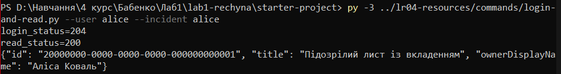
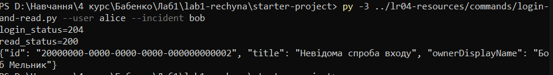
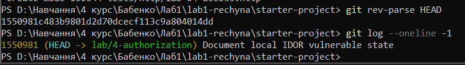

**Першопричина.** Маршрут не мав `RequireAuthorization()`, а `IncidentQueries.GetDetailsAsync` фільтрував лише за `incident.Id == id`, без перевірки `OwnerUserId` і ролі.

**Виправлення.**
- Групу `/api/incidents` і маршрут `/api/incident-comments/{id}` захищено `RequireAuthorization()`.
- Правила зібрано в `IncidentAccess`. У `IncidentQueries` застосовано query scoping за `userId` і роллю (`list`, `details`, `comment`), internal коментарі бачить лише Analyst.
- Додано `PUT`, `DELETE`, `triage` з перевіркою власника/ролі до зміни стану. `UpdateIncidentRequest` має лише `Title` і `Description`, тож `ownerUserId`, `role`, `status` з body ігноруються.

**Retest.** Alice → чужий `incident-2` тепер `404` без даних Bob. Її `PUT` і `DELETE` для `incident-2` дають `404` і не змінюють БД. Свій інцидент Alice читає (`200`), Morgan читає інцидент Alice разом з internal коментарем.

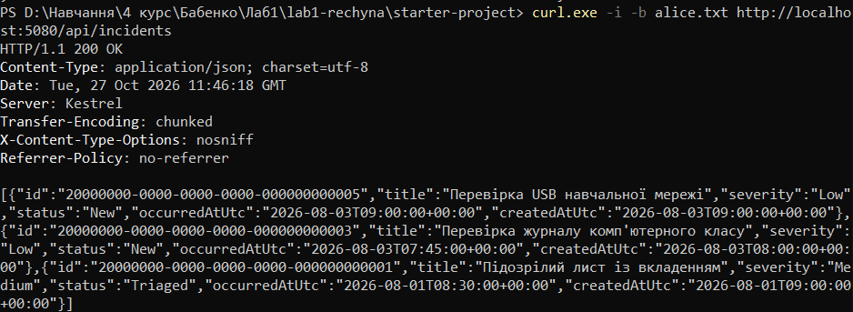
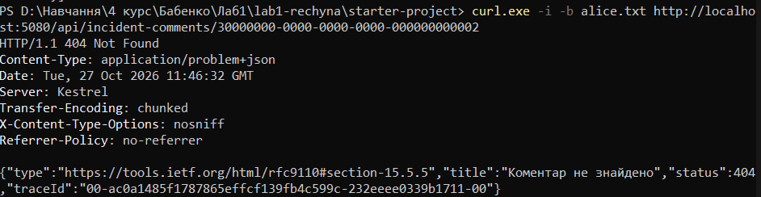
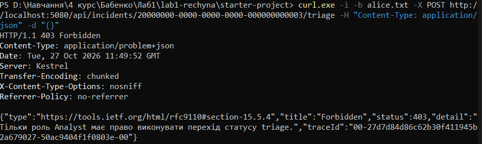
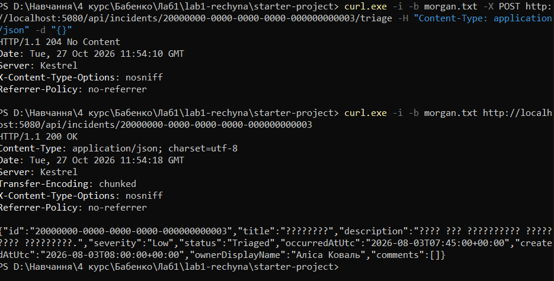
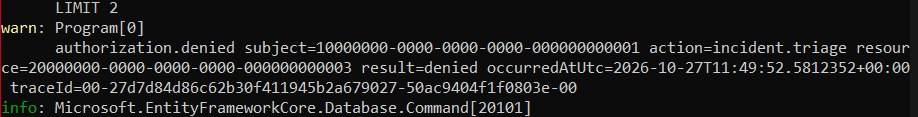
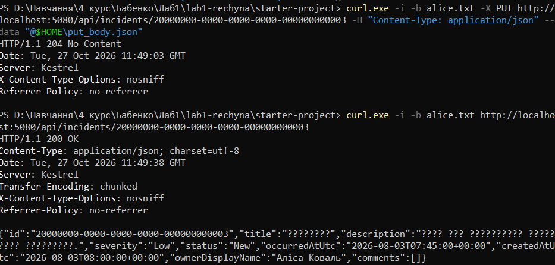

**Browser client.** Власний інцидент показується, для чужого виводиться «Помилка: Інцидент не знайдено» (через `textContent`).

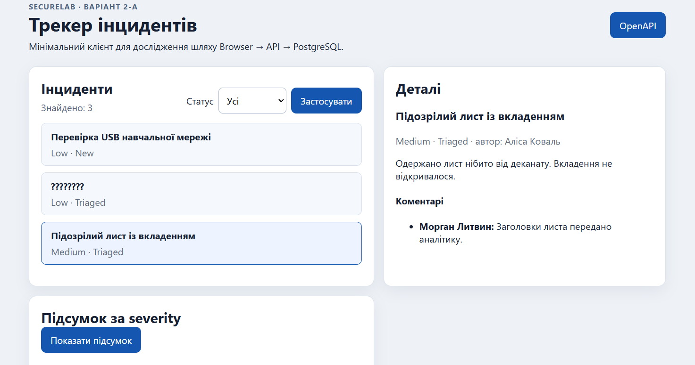
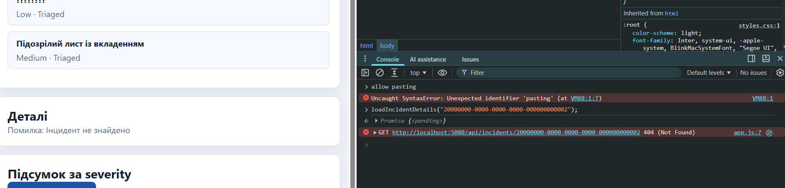

## 4. Доказова таблиця

| ID | Рівень | Сценарій | Передумови | Дія | Очікувано | Фактично | Доказ |
|---|---|---|---|---|---|---|---|
| A-01 | добрий | Анонімний доступ | без cookie | `GET /api/incidents` і `/{id}` | `401`, без redirect | `401`, `Location` немає | тест `Anonymous_…_Return401_NotRedirect` |
| A-02 | достатній | Власний ресурс | `alice`, `incident-1` | `GET` details | `200` | `200`, id збігається | тест `GetDetails_AsOwnerAlice…`, Л4-13 |
| A-03 | достатній | Чужий ресурс | `alice`, id Bob | `GET` details | `404`, даних Bob немає | `404` | тест `GetDetails_AsNonOwnerAlice…`, Л4-14 |
| A-03R | достатній | Аналітичний read | `morgan`, `incident-1` | `GET` і `PUT` | read `200`, `PUT` `404` | `200` з internal коментарем, `PUT` `404` | тест `GetDetails_AsAnalystMorgan…` |
| A-04 | добрий | Чужий ресурс, зміни | `alice`, `incident-2` | `PUT`, `DELETE` | `404`, БД без змін | `404`, поля не змінилися | тест `UpdateAndDelete_AsNonOwnerAlice…` |
| A-05 | добрий | List scoping | `alice` | `GET /api/incidents` | лише власні | `0001`, `0003`, `0005` | тест `GetList_AsAlice…`, Л4-06 |
| A-06 | добрий | Вертикальне підвищення | `alice` (Reporter), інцидент `New` | `POST …/triage` | `403`, статус `New` | `403`, статус не змінився | тест `Triage_AsReporterAlice…`, Л4-08 |
| A-07 | добрий | Дозволена дія | `morgan` (Analyst), інцидент `New` | `POST …/triage` двічі | `204`, потім `409` | `204`, статус `Triaged`, повтор `409` | тест `Triage_AsAnalystMorgan…`, Л4-09 |
| A-08a | добрий | Overposting | `alice`, власний інцидент | `PUT` з `ownerUserId`, `role`, `status` | `204`, owner і status без змін | `204`, owner Alice, статус `New` | тест `Update_WithForgedOwnerRoleAndStatus…`, Л4-11 |
| A-08b | добрий | Альтернатива A-08a | — | — | — | не виконувалось: обрано A-08a | — |
| A-09 | добрий | Audit | відмова triage для Reporter | перегляд логу API | подія без секретів | `authorization.denied` з `traceId`, без паролів і cookie | Л4-10, Л4-08 |
| A-10 | добрий | Нерозрізнюваність 404 | `alice`, id Bob і випадковий Guid | два `GET` | однакові status, Content-Type, тіло | збігаються (крім `traceId`) | тест `GetDetails_AsNonOwnerAlice…ReturnsSame404…` |
| A-11 | відмінний | search, severity-summary | — | — | — | не виконувалось: рівень відмінний | — |
| A-12 | добрий | Child і internal comment | `alice`; `comment-2`, `comment-3` | `GET /api/incident-comments/{id}` | `404` для Alice, `200` для Morgan | `404` для обох, Morgan `200` | тест `ChildComments_AsReporterAlice…`, Л4-07 |

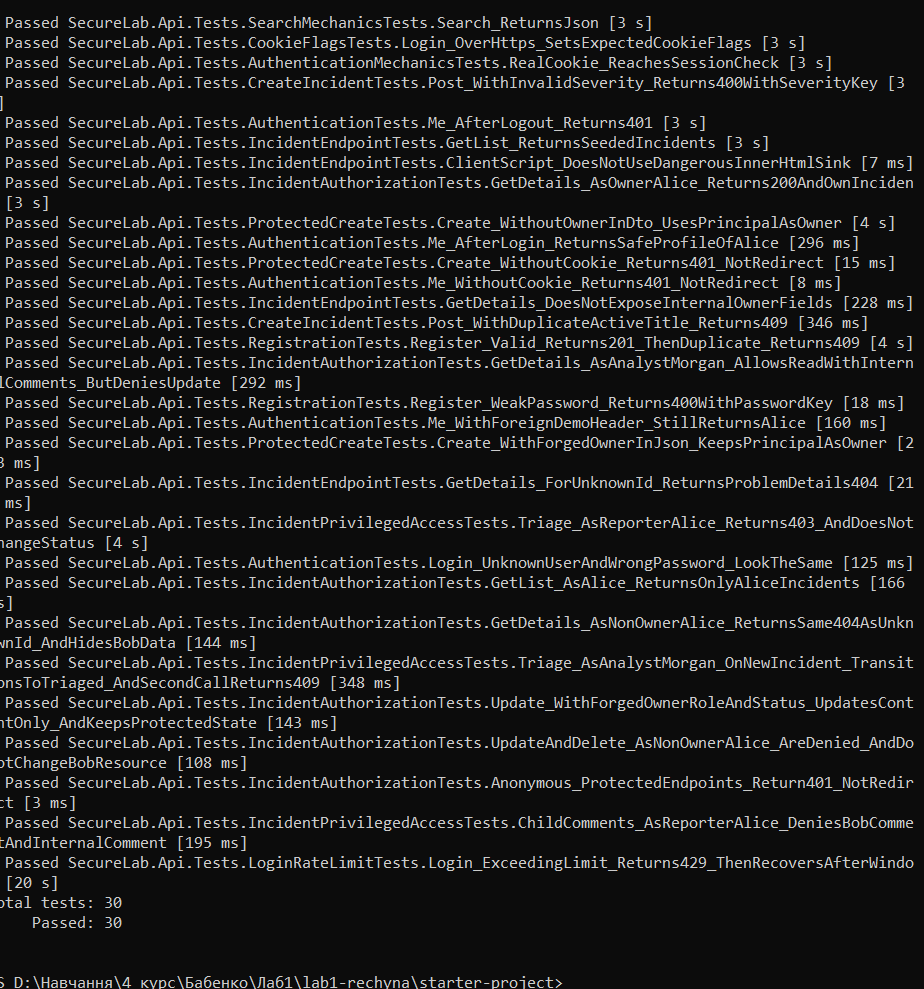

